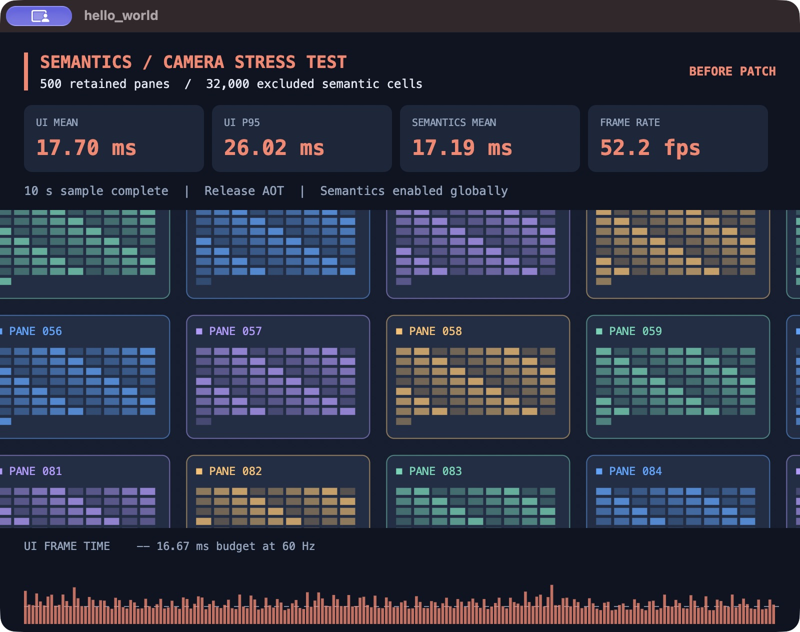
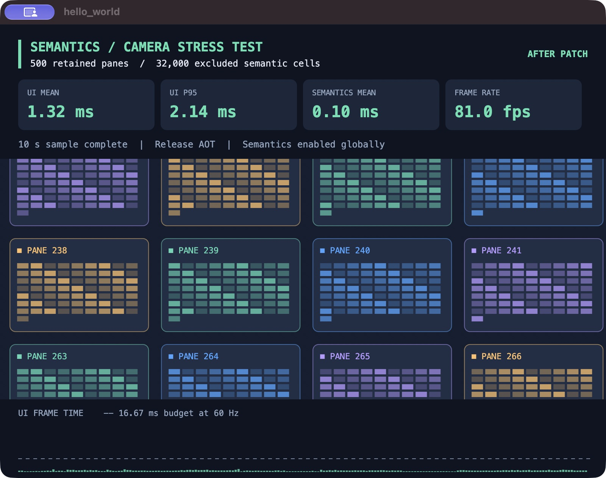

# Semantics geometry regression repro

A standalone Flutter macOS app that reproduces repeated geometry work beneath `ExcludeSemantics` while the camera moves.

## Run the demo

Use a Flutter SDK with Dart 3.13 or later and macOS desktop support.

```sh
flutter pub get
flutter run -d macos --release
```

The app warms up for five seconds, then measures ten seconds of camera motion. It displays UI time, semantics time, frame rate, and a frame-time chart. The camera continues moving after the measurements finish.

To label a run, pass `VARIANT`. This changes the label and result filename. The selected Flutter SDK determines whether the framework patch is present.

```sh
flutter run -d macos --release --dart-define='VARIANT=BEFORE PATCH'
```

Run the same command with a patched SDK and `--dart-define='VARIANT=AFTER PATCH'` to compare results.

The app writes JSON measurements to `Directory.systemTemp` and prints the full path. A sandboxed macOS Release app uses a temporary directory inside its application container.

See [how the repro works](docs/reproduction.md) for the trigger and measurement definitions. The [framework patch](patches/semantics-geometry-rejoin.patch) is included for reference.

## View the captured results

Both screenshots show the same 500-pane demo with 32,000 excluded semantic cells in Release mode.

| Measurement | Before patch | After patch |
| --- | ---: | ---: |
| UI mean | 17.70 ms | 1.32 ms |
| UI p95 | 26.02 ms | 2.14 ms |
| Semantics mean | 17.19 ms | 0.10 ms |
| Observed frame rate | 52.2 fps | 81.0 fps |

These are individual interactive runs. Frame rate can vary with desktop activity and display scheduling.

### Before patch



### After patch



The [original demo source](docs/measurements/visual_repro.dart), [before measurements](docs/measurements/visual-before.json), [after measurements](docs/measurements/visual-after.json), and [source hashes](docs/measurements/visual-manifest.json) preserve the captured runs.
